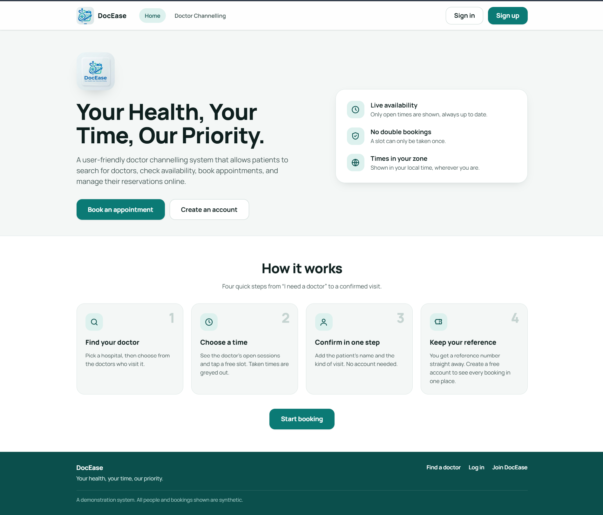
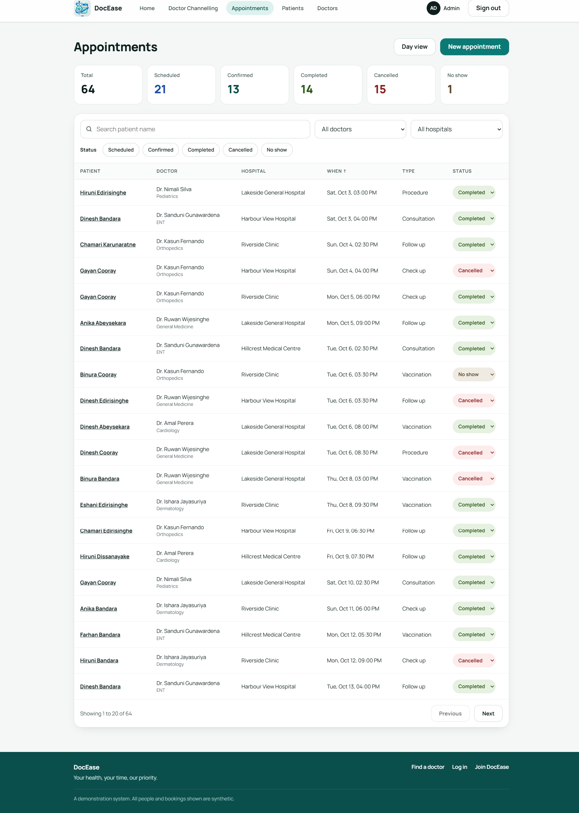
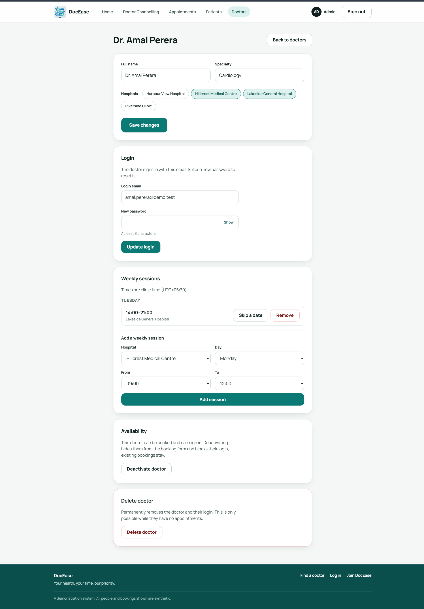
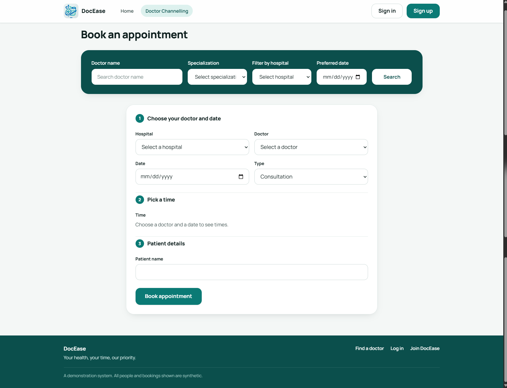

# DocEase

A simple web app for booking and managing doctor appointments.

- **Patients** find a doctor, pick a time and get a reference number (and a PDF receipt). No account is needed to book.
- **Doctors** see their appointments, weekly sessions and patients.
- **Admins** manage doctors, their weekly sessions, patients and all bookings.

> The demo data is synthetic. Do not enter real personal data.

## Features

| Who | What they can do |
| --- | --- |
| Anyone | Search doctors (name, specialization, hospital, date), book online, download a PDF receipt |
| Patient (optional account) | Sign up, view old bookings, edit or delete the account |
| Doctor | View appointments, weekly sessions and patient details, edit or delete the account |
| Admin | Add, edit and delete doctors, set their sessions, view all patients and bookings |

## Tech stack

- **Frontend:** React, Vite, TanStack Query
- **Backend:** FastAPI, SQLAlchemy 2, Alembic, Pydantic v2
- **Database:** PostgreSQL (Supabase)
- **Auth:** JWT

## UI design

The interface is clean, calm and mobile friendly.

- **Colours:** teal brand colour (`#0b7a75`) on a soft off-white background, with white cards and rounded corners.
- **Font:** Manrope.
- **Home page:** a hero section, a short list of benefits and a 4-step "How it works": *Find your doctor → Choose a time → Confirm in one step → Keep your reference*.
- **Book an appointment:** a search bar at the top (doctor name, specialization, hospital, date). Choosing a doctor fills the booking form below, which has three steps: *doctor and date → time → patient details*.
- **Time picker:** 30-minute slots. Taken times are disabled.
- **Confirmation:** the reference number, the appointment details and a *Download receipt (PDF)* button.
- **Sign in / Sign up:** a simple split layout with a show/hide password option.
- **Dashboards:** appointment list with search, filters, status badges and a day view. Admin and doctor pages share the same look.

## Screenshots

### Home Page



### Admin Dashboard



### Doctor Dashboard



### Booking Page



## Getting started

You need **Python 3.12+**, [uv](https://docs.astral.sh/uv/), **Node.js 20+** and a Postgres database (a free Supabase project works).

### 1. Backend

```bash
cd backend
uv sync
cp .env.example .env        # then fill in your values (see below)
uv run alembic upgrade head # create the tables
uv run python -m scripts.seed  # optional demo data
uv run uvicorn app.main:create_app --factory --reload --no-access-log
```

The API runs at <http://localhost:8000>.

Main settings in `backend/.env`:

| Variable | Meaning |
| --- | --- |
| `DATABASE_URL` | Supabase transaction pooler (used by the app) |
| `DATABASE_URL_MIGRATIONS` | Supabase session pooler (used by Alembic and tests) |
| `JWT_SECRET` | Random string, at least 32 characters |
| `CORS_ORIGINS` | Allowed frontend address, e.g. `http://localhost:5173` |
| `CLINIC_UTC_OFFSET_MINUTES` | Clinic local time as minutes from UTC (e.g. `330` for Sri Lanka). Default `0` |

### 2. Frontend

```bash
cd frontend
npm install
npm run dev
```

Open <http://localhost:5173>. The dev server forwards `/api` to the backend.

### Demo logins

After running the seed script: `admin@demo.test` or any seeded doctor account, with password `demo-password-123`. Patients can sign up from the site.

## Tests and checks

```bash
# Backend (from backend/)
uv run pytest --cov=app --cov-fail-under=80
uv run ruff check . && uv run mypy

# Frontend (from frontend/)
npm test
npm run lint
npm run build
```

Tests run against a throwaway schema, so your data is not touched. CI runs the same checks on every pull request.

## Project structure

```
backend/    FastAPI app: api/ (routes) → services/ → repositories/ → models/
frontend/   React app: pages/, components/, hooks/, api/, utils/
docs/       ARCHITECTURE.md (plan and API contract), DECISIONS.md
```

See [docs/ARCHITECTURE.md](docs/ARCHITECTURE.md) for the full API list and design notes.

## Security notes

- Passwords are hashed; sessions use short-lived JWTs.
- Patient names and other personal data are never logged.
- All times are stored in UTC and shown in local time.
- Secrets live in `.env` files, which are never committed.
